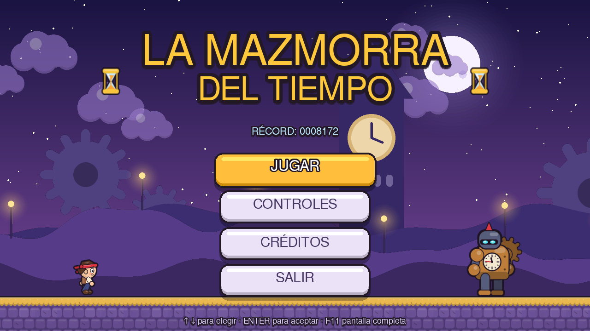
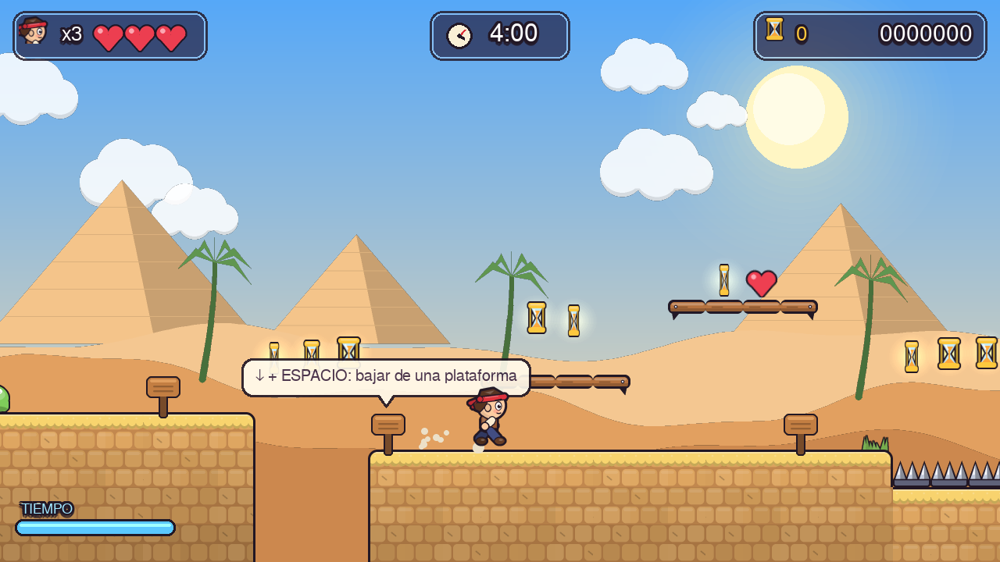
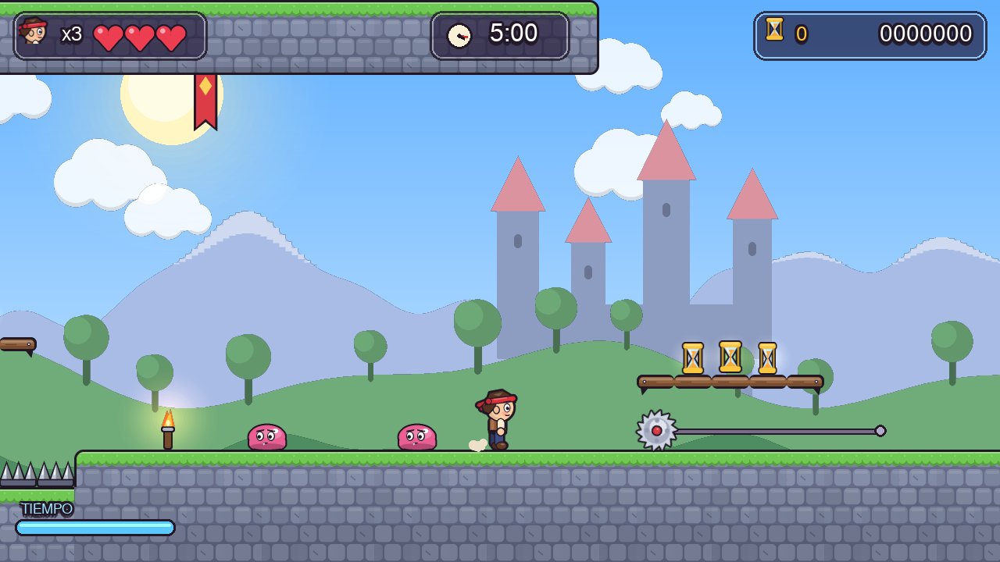
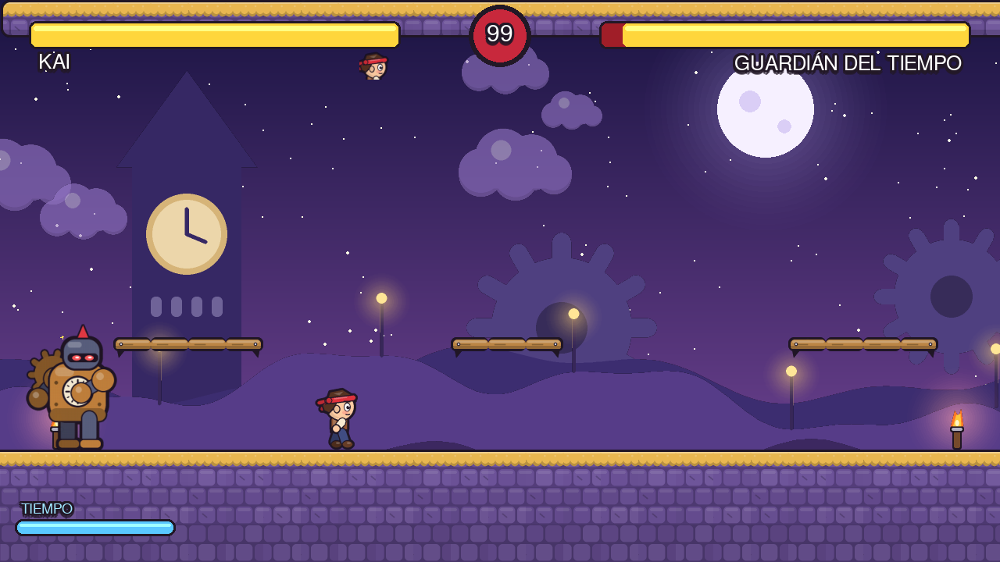

# ⏳ La Mazmorra del Tiempo

Videojuego de plataformas 2D en **Python + pygame-ce**, hecho en equipo con Git Flow simplificado.
Mezcla el plataformeo de *Mario Bros*, la estética cartoon de *Papa Louie*, las trampas de
*Prince of Persia* y una pelea final 1 vs 1 al estilo *Street Fighter*.



| Nivel 1 — Ruinas del Desierto | Nivel 2 — Castillo Olvidado | Nivel 3 — Torre del Reloj (jefe) |
|---|---|---|
|  |  |  |

---

## 🎮 Cómo jugar

| Acción | Teclado | Mando |
|---|---|---|
| Moverse | ← → o A D | Stick / cruceta |
| Saltar (mantén para saltar más alto) | Espacio / W / ↑ | A |
| Golpe | J / X | B / X |
| **Rebobinar el tiempo** (mantener) | K / Shift | LB / RB |
| Bajar de una plataforma | ↓ + Espacio | — |
| Pausa | Esc / P | Start |
| Pantalla completa | F11 | — |

**Objetivo:** cruza los 3 niveles antes de que se acabe el tiempo, recoge relojes de arena
y derrota al **Guardián del Tiempo** para abrir el portal final.

### Mecánicas
- **Física de plataformas con "game feel":** coyote time, buffer de salto, salto variable, squash & stretch.
- **Combate:** pisa a los enemigos (estilo Mario) o golpéalos.
- **Rebobinar el tiempo:** vuelve atrás hasta 3 segundos (consume energía que se recarga).
- **Salud y vidas:** 3 corazones por vida, 3 vidas. Puntos de control (banderas) en cada nivel.
- **Trampas:** pinchos, sierras en rieles, bloques que se derrumban, plataformas móviles, vacíos.
- **Jefe final:** embestida, pisotón con ondas de choque y lanzamiento de engranajes; fase 2 a mitad de vida.
- **Puntuación persistente:** el récord se guarda en `save.json`.

---

## ⚙️ Instalación

Requisitos: **Python 3.13** (también funciona con 3.10–3.14).

```bash
# 1. Clonar
git clone https://github.com/<usuario>/mazmorra-del-tiempo.git
cd mazmorra-del-tiempo

# 2. Entorno virtual (recomendado)
python -m venv .venv
.venv\Scripts\activate          # Windows
# source .venv/bin/activate     # macOS / Linux

# 3. Dependencias
pip install -r requirements.txt

# 4. Jugar
python main.py
```

> ⚠️ Usamos **pygame-ce** (Community Edition), no `pygame`. Si tienes `pygame` instalado, desinstálalo primero: `pip uninstall pygame`.

### Generar un ejecutable (.exe)
```bash
pip install pyinstaller
pyinstaller --noconsole --onedir --name MazmorraDelTiempo --add-data "levels;levels" --add-data "assets;assets" main.py
```
El juego queda en `dist/MazmorraDelTiempo/`.

---

## 🧱 Arquitectura

Todo el arte, la música y los sonidos se **generan por código** (dibujo vectorial con
supersampling y contornos). No hay imágenes descargadas ni generadas con IA.

```
mazmorra-del-tiempo/
├── main.py                 # Punto de entrada
├── settings.py             # Constantes (física, tamaños, colores, controles)
├── core/                   # 👤 Integrante 1 — motor y mecánicas
│   ├── game.py             #   bucle principal y gestor de escenas
│   ├── play_scene.py       #   escena de juego: muerte, reaparición, Game Over, cambio de nivel
│   ├── player.py           #   movimiento, salto, golpe, daño, rebobinar
│   ├── physics.py          #   colisiones con tiles y plataformas
│   ├── camera.py           #   cámara con suavizado y temblor
│   ├── game_state.py       #   vidas, puntuación y récord persistente
│   ├── input.py · audio.py · particles.py · assets.py
├── art/                    # Arte procedural compartido
│   ├── draw.py             #   primitivas vectoriales + contorno cartoon
│   ├── characters.py       #   jugador, enemigos y jefe
│   ├── world.py            #   tiles, trampas, objetos, decoración y temas
│   ├── backgrounds.py      #   fondos con parallax
│   └── text.py             #   fuentes y texto con contorno
├── entities/
│   ├── base.py             # 👤 Integrante 1 — clase base
│   ├── items.py            # 👤 Integrante 2 — relojes, corazones, checkpoints, portal, carteles
│   ├── traps.py            # 👤 Integrante 2 — pinchos, sierras, plataformas
│   ├── enemies.py          # 👤 Integrante 2 — slime y murciélago
│   └── boss.py             # 👤 Integrante 3 — Guardián del Tiempo
├── levels/
│   ├── level_base.py       # 👤 Integrante 1 — cargador genérico de niveles JSON
│   ├── nivel_prueba.json   # 👤 Integrante 1 — sandbox para probar físicas
│   ├── nivel_1.json        # 👤 Integrante 2
│   ├── nivel_2.json        # 👤 Integrante 2
│   └── nivel_3.json        # 👤 Integrante 3
├── ui/                     # 👤 Integrante 3 — interfaz
│   ├── menu.py · hud.py · pause.py · game_over.py · victory.py · level_cards.py · widgets.py
├── assets/                 # (opcional) fuentes, sonidos y música propios
└── docs/                   # guía del equipo y capturas
```

### Modularidad (requisito clave)
- **Cada nivel es un archivo JSON independiente.** Modificar `nivel_2.json` nunca toca el código del jugador ni del Nivel 1.
- **Los módulos son opcionales:** si una rama todavía no se fusionó (por ejemplo `ui/` o `entities/boss.py`),
  el juego sigue arrancando sin esa parte. Así `main` siempre es jugable después de cada merge.

### Crear o editar un nivel
Los niveles se dibujan con caracteres. Leyenda completa en `levels/level_base.py`:

```
#  bloque sólido     =  plataforma de un sentido   ^  pinchos      F  bloque que se cae
o  reloj de arena    h  corazón                    C  checkpoint   E  portal de salida
s  slime             b  murciélago                 B  jefe         P  inicio del jugador
k  caja              t  antorcha  v  jarrón  n  estandarte  "  hierba (decoración)
```
Los objetos con parámetros (sierras, plataformas móviles, carteles) van en la lista `"entities"` del JSON.

---

## 🌿 Flujo de trabajo en Git

- `main` solo contiene versiones **estables y jugables**. Prohibido hacer commits directos.
- Ramas: `feature/movimiento-jugador`, `feature/nivel-1`, `feature/nivel-2`, `feature/nivel-3`, `feature/interfaz-menu`.
- Todo entra por **Pull Request** con descripción + captura/GIF y **aprobación de al menos un compañero**.
- Tablero en **GitHub Projects**: To Do → In Progress → In Review → Done.

Detalles en [CONTRIBUTING.md](CONTRIBUTING.md) y la guía paso a paso en [docs/GUIA_EQUIPO.md](docs/GUIA_EQUIPO.md).

---

## 👥 Equipo

| Rol | Integrante | Responsabilidades |
|---|---|---|
| Líder de Físicas y Mecánicas | _Nombre 1_ | Jugador, físicas, vidas, Game Over, cambio de nivel, puntuación |
| Diseñador de Niveles 1 y 2 | _Nombre 2_ | Nivel 1 (tutorial), Nivel 2 (trampas), objetos, enemigos |
| Diseñador de Nivel 3 y UI | _Nombre 3_ | Nivel 3 + jefe final, HUD, menús, victoria |

## 📜 Créditos
- Motor: [pygame-ce](https://pyga.me/) (LGPL).
- Arte, música y efectos: generados por código por el equipo.
